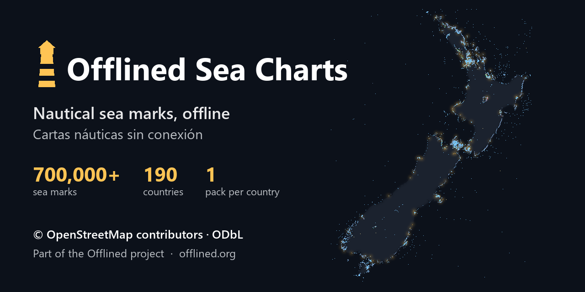

# ⚓ Offlined Sea Charts



**The sea marks of OpenStreetMap, ready to use without internet.**
A project of **[Offlined](https://www.offlined.org)** by **Álvaro C. Chulvi** · Data © **OpenStreetMap contributors**, ODbL

[English](#english) · [Español](#español)

---

## English

Offlined Sea Charts is the data behind **World → Seas & Oceans → Nautical charts** in
[Offlined](https://www.offlined.org), the app that brings Wikipedia, maps and AI to your computer without
internet. It publishes **one small file per country** with every sea mark that OpenStreetMap has there:
lighthouses, buoys, beacons, harbours, anchorages, moorings and hazards (reefs, shoals and rocks).

| Release | OSM data from | Countries | Sea marks | All packs |
|---|---|---:|---:|---:|
| `osm-2026-10-31` | 2026-10-31 | ~190 | ~1,000,000 | 🛠️ Being built: the planet is being fetched from OpenStreetMap |

- **`seamarks-<ISO>.json.gz`** (in [Releases](../../releases)): `{"key", "date", "count", "features": [[id, lon, lat, {tags}], …]}`.
  `id` is the OpenStreetMap element (`node/123`, `way/456`, ways as their centre) and `tags` are its OSM
  tags as they are (`seamark:*`, `name`, `natural`…).
- **`manifest.json`**: every pack with its size, MD5 and number of sea marks.

A country is its land plus its exclusive economic zone (Marine Regions «eez_land»), so a sea mark near a
border can be in two packs.

> ⚠️ **Not for navigation.** OpenStreetMap sea marks are mapped by volunteers and may be incomplete, wrong
> or out of date. Use the official charts of your hydrographic office for anything involving safety at sea.

### Why

Offlined used to ask the public Overpass servers for each country from every user's computer. Those
servers are shared and often full, so downloads failed. Now the planet is fetched **once per release**,
slowly and one query at a time, and everyone downloads the result from GitHub. Offlined still falls back
to Overpass for a country that is not in the latest release.

### In Offlined

Open **Seas & Oceans → Nautical charts**, pick countries and press download. Offlined reads
[`manifest.json`](../../releases/latest/download/manifest.json) from the latest release, checks the MD5
of each pack and stores it in its local database.

### Rebuild it

The scripts in [`scripts/`](scripts) (Python 3.11, `pip install requests shapely`) rebuild everything:

```bash
cd scripts
python fetch_tiles.py 0/2 & python fetch_tiles.py 1/2   # planet in 10° tiles, a few hours, resumable
python build_packs.py osm-YYYY-MM-DD                     # → work/release/ (packs + manifest.json)
```

The country zones come from `chart_zones.json`, made by
[`build_chart_zones.py`](https://github.com/Aruvaro-Chulvi/OfflinedSeafloor/blob/main/scripts/build_chart_zones.py)
(set `CHART_ZONES` to its path). Upload the files of `work/release/` to a release named after the tag.

### Fixing the data

A sea mark that is wrong or missing must be fixed **in OpenStreetMap** ([openstreetmap.org](https://www.openstreetmap.org/fixthemap)):
it arrives here with the next release. For problems with the packs themselves, [open an issue](../../issues/new/choose).

### License

The packs are an extract of OpenStreetMap: **© OpenStreetMap contributors, [ODbL 1.0](LICENSE)**. You may
use, share and adapt them, also commercially, crediting OpenStreetMap and keeping them under the ODbL.
Scripts: [PolyForm Noncommercial 1.0.0](LICENSE-CODE.md). See [NOTICE.md](NOTICE.md).

---

## Español

Offlined Sea Charts son los datos de **Mundo → Mares y Océanos → Cartas náuticas** en
[Offlined](https://www.offlined.org), la app que lleva Wikipedia, mapas e IA a tu ordenador sin internet.
Publica **un archivo pequeño por país** con todas las señales marítimas que OpenStreetMap tiene allí:
faros, boyas, balizas, puertos, fondeaderos, amarres y peligros (arrecifes, bajos y rocas).

| Release | Datos de OSM del | Países | Señales | Todos los paquetes |
|---|---|---:|---:|---:|
| `osm-2026-10-31` | 31-10-2026 | ~190 | ~1.000.000 | 🛠️ En preparación: se está bajando el planeta de OpenStreetMap |

- **`seamarks-<ISO>.json.gz`** (en [Releases](../../releases)): `{"key", "date", "count", "features": [[id, lon, lat, {etiquetas}], …]}`.
  `id` es el elemento de OpenStreetMap (`node/123`, `way/456`, las vías por su centro) y las etiquetas son
  las de OSM tal cual (`seamark:*`, `name`, `natural`…).
- **`manifest.json`**: cada paquete con su tamaño, su MD5 y su número de señales.

Un país es su tierra más su zona económica exclusiva (Marine Regions «eez_land»), así que una señal cerca de
una frontera puede estar en dos paquetes.

> ⚠️ **No apto para navegar.** Las señales de OpenStreetMap las mapean voluntarios y pueden faltar, estar
> mal o desfasadas. Para todo lo que tenga que ver con la seguridad en el mar, usa las cartas oficiales de
> tu instituto hidrográfico.

### Por qué

Antes Offlined pedía cada país a los servidores públicos de Overpass desde el ordenador de cada usuario.
Esos servidores son compartidos y se llenan a menudo, y las descargas fallaban. Ahora el planeta se baja
**una vez por release**, despacio y de consulta en consulta, y todo el mundo descarga el resultado de
GitHub. Si un país no está en la última release, Offlined sigue pidiéndolo a Overpass.

### En Offlined

Abre **Mares y Océanos → Cartas náuticas**, elige países y descarga. Offlined lee
[`manifest.json`](../../releases/latest/download/manifest.json) de la última release, comprueba el MD5 de
cada paquete y lo guarda en su base de datos local.

### Regenerarlo

Los pasos están arriba, en inglés: `fetch_tiles.py` baja el planeta en cuadros de 10° (unas horas, se puede
continuar si se corta) y `build_packs.py` reparte por países y escribe la release en `work/release/`.

### Corregir los datos

Una señal mal puesta o que falta se corrige **en OpenStreetMap** ([openstreetmap.org](https://www.openstreetmap.org/fixthemap)):
llegará aquí con la siguiente release. Para problemas con los paquetes, [abre un aviso](../../issues/new/choose).

### Licencia

Los paquetes son un extracto de OpenStreetMap: **© colaboradores de OpenStreetMap, [ODbL 1.0](LICENSE)**.
Puedes usarlos, compartirlos y adaptarlos, también con fines comerciales, citando a OpenStreetMap y
manteniéndolos bajo la ODbL. Scripts: [PolyForm Noncommercial 1.0.0](LICENSE-CODE.md). Ver [NOTICE.md](NOTICE.md).
